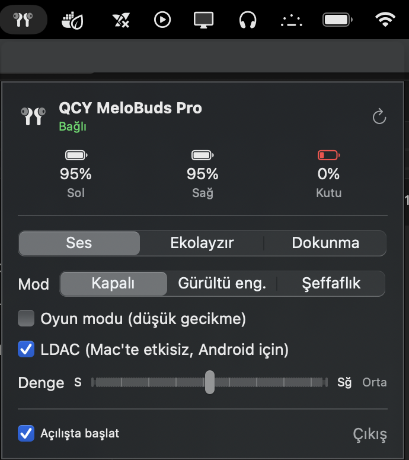
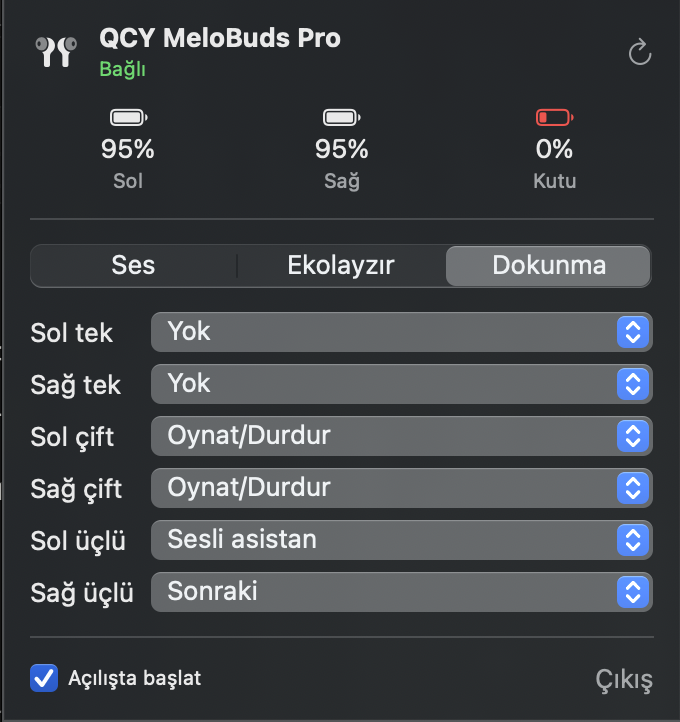

# QCY Control for macOS

> Fork of [Muyubu1/qcy-control-macos](https://github.com/Muyubu1/qcy-control-macos) with QCY MeloBuds N65 support and an English UI.

A tiny native **macOS menu bar app** to control **QCY MeloBuds Pro** and **MeloBuds N65** earbuds from your Mac — no phone needed.
Switch **ANC / transparency**, change the **EQ**, toggle **gaming mode**, adjust **L/R balance** and remap **touch controls**.

> Unofficial. Not affiliated with QCY. Tested on QCY MeloBuds Pro (vendorId 19786, firmware 2.0.4) on macOS (Apple Silicon).

[Türkçe açıklama aşağıda](#türkçe)

<p>
  
  
</p>

## Features
- Battery for left, right and case (with charging state)
- Noise control: **Off / ANC / Transparency**
  - ANC scenes: Adaptive, Indoor, Commuting, Noisy, Anti-wind (with levels)
  - Transparency levels 1–7
- 10-band EQ (±8 dB) with presets
- Gaming mode (low latency), LDAC switch
- Left/right sound balance
- Touch control remapping (single / double / triple tap, per side)
- Live sync: changing modes on the earbuds updates the app
- Menu bar icon appears **only while the earbuds are connected**; starts at login

Deliberately **not** included: factory reset, clear pairing, test mode, firmware update.

## Install
Requirements: macOS 13+, Xcode Command Line Tools (`xcode-select --install`).

```bash
git clone https://github.com/Muyubu1/qcy-control-macos
cd qcy-control-macos/app
./build.sh
cp -R "QCY Control.app" /Applications/
open "/Applications/QCY Control.app"
```
Allow Bluetooth access when macOS asks. The build is ad-hoc signed for local use.

## How it works
QCY earbuds stream audio over Classic Bluetooth and expose settings over **BLE GATT**:

| UUID | Role |
|---|---|
| `0000a001` | QCY service |
| `00001001` | command write (framed) |
| `00001002` | notifications (framed) |
| `00000008` | battery L/R/case |
| `0000000b` | EQ: `[presetIndex, 10 × int8 gain]` |
| `0000000d` | key map: `[keyId, funcId] × n` |

Frame: `FF <len> <cmd> <paramLen> <params…>`. Examples on MeloBuds Pro:

| Action | Bytes |
|---|---|
| ANC on (indoor, level 3) | `FF 05 17 03 01 01 02` |
| Normal (ANC off) | `FF 05 17 03 02 00 00` |
| Transparency level 5 | `FF 05 17 03 03 01 04` |
| Gaming mode on / off | `FF 03 09 01 01` / `…02` |
| Ask current value of cmd X | `FF 03 FE 01 X` |

`tools/` has two read-only Python scripts (`bleak`) for discovering a QCY device and dumping its current settings — useful to check whether another QCY model is compatible.

### Other QCY models
Models exposing the same `a001` service will likely work for battery/ANC on/off. ANC scene IDs differ per model; PRs with tested models are welcome.

### MeloBuds N65 (JieLi chip)
Supported: battery; **ANC scenes** (Adaptive, Noisy, Commuting, Indoor with 3 levels, Anti-wind), off, **transparency 1–7**; **EQ** (the 7 official presets + a custom 10-band EQ layered on the Default tuning); Dynamic EQ; Spatial Audio (off / fixed / head tracking); LDAC and multi-device switches (both restart the earbuds); L/R balance; touch controls including long press. Not included: gaming mode (QCY's app warns it reboots the earbuds) and "AI Scene Noise Cancellation" (cmd `0x54`, format not decoded yet).

The ANC scene IDs, EQ presets and setting commands come from QCY's own control-panel definition for the N65 (`api.watch.qcy.com/product/findControlPanels`, modelId 32891).

The N65 (fw 2.0.11) has no `a001` service. Its BLE link (`QCY MeloBuds N65-APP`) exposes service `a002` with `0001` (write) and `0002` (notify). The **same QCY commands** are carried inside JieLi RCSP framing:

```
FE DC BA <flag> FF <lenH> <lenL> [status] <seq> <cmd> <plen> <params…> EF
```
- we send flag `C0` (command, reply wanted); the earbuds reply with flag `00` + status (`00` = OK) and push changes with flag `80` (no status byte)
- e.g. ANC off: `FE DC BA C0 FF 00 06 01 17 03 02 00 00 EF`; ask ANC state: `FE DC BA C0 FF 00 04 02 FE 01 17 EF`
- EQ is cmd `0x22`: `[presetId, masterGain×100 (int16 LE), n × (freq u16, gain×100 i16, Q×100 u16, filterType u8)]`; up to 18 bands accepted; writing an EQ turns Dynamic EQ (`0x27`) off
- changing Spatial Audio (`0x5B`) restarts the BLE control link for a few seconds
- battery (`0x2F`, `[left, right, case]`, bit 7 = charging) is pushed when a bud goes into the case. The case has no radio of its own: its level is only real while a bud sits in it; otherwise the earbuds repeat the last value (the app shows it greyed out as "last known"), and charging the case with both buds out can't be seen
- commands an N65 doesn't know get no reply at all; the first command after subscribing is sometimes dropped
- a second noise-mode change within ~1.5 s is ignored, so the app spaces them ≥ 2 s apart
- key map is `0x2B` with `[keyId, funcId]` pairs; `0x0B` is the noise-control cycle (default on right long press)

Run the app binary with `QCY_DEBUG=1` to log every decoded command — handy when adding another model.

## Credits
Protocol knowledge from **[hui1601/Quicky](https://github.com/hui1601/quicky)** (Linux/Go), which documents the QCY BLE protocol. This app is an independent Swift implementation for macOS.

## License
MIT

---

## Türkçe
QCY MeloBuds Pro kulaklığı Mac'ten yönetmek için menü çubuğu uygulaması: gürültü engelleme, şeffaflık, ekolayzır, oyun modu, ses dengesi ve dokunma ayarları. Simge yalnız kulaklık bağlıyken görünür, Mac açılışında kendiliğinden başlar. Kurulum için yukarıdaki "Install" adımlarını izleyin (uygulama artık "QCY Control.app" adıyla ve İngilizce arayüzle derlenir).
