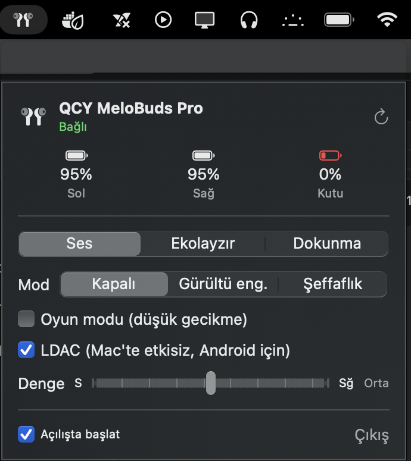
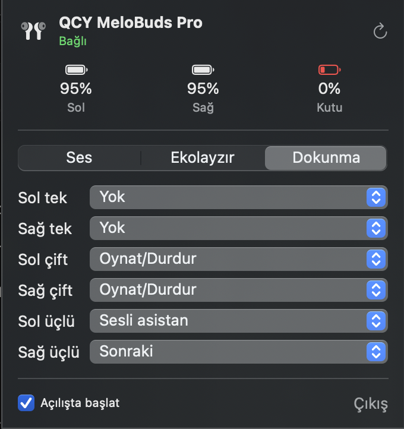

# QCY Control for macOS

A tiny native **macOS menu bar app** to control **QCY MeloBuds Pro** earbuds from your Mac — no phone needed.
Switch **ANC / transparency**, change the **EQ**, toggle **gaming mode**, adjust **L/R balance** and remap **touch controls**.

> Unofficial. Not affiliated with QCY. Tested on QCY MeloBuds Pro (vendorId 19786, firmware 2.0.4) on macOS (Apple Silicon).

[Türkçe açıklama aşağıda](#türkçe)

<p>
  
  
</p>

## Features
- Battery for left, right and case (with charging state)
- Noise control: **Off / ANC / Transparency**
  - ANC scenes: Adaptive, Indoor, Commuting, Noisy, Anti-wind (with levels)
  - Transparency levels 1–7
- 10-band EQ (±8 dB) with presets
- Gaming mode (low latency), LDAC switch
- Left/right sound balance
- Touch control remapping (single / double / triple tap, per side)
- Live sync: changing modes on the earbuds updates the app
- Menu bar icon appears **only while the earbuds are connected**; starts at login

Deliberately **not** included: factory reset, clear pairing, test mode, firmware update.

## Install
Requirements: macOS 13+, Xcode Command Line Tools (`xcode-select --install`).

```bash
git clone https://github.com/Muyubu1/qcy-control-macos
cd qcy-control-macos/app
./build.sh
cp -R "QCY Kontrol.app" /Applications/
open "/Applications/QCY Kontrol.app"
```
Allow Bluetooth access when macOS asks. The build is ad-hoc signed for local use.

## How it works
QCY earbuds stream audio over Classic Bluetooth and expose settings over **BLE GATT**:

| UUID | Role |
|---|---|
| `0000a001` | QCY service |
| `00001001` | command write (framed) |
| `00001002` | notifications (framed) |
| `00000008` | battery L/R/case |
| `0000000b` | EQ: `[presetIndex, 10 × int8 gain]` |
| `0000000d` | key map: `[keyId, funcId] × n` |

Frame: `FF <len> <cmd> <paramLen> <params…>`. Examples on MeloBuds Pro:

| Action | Bytes |
|---|---|
| ANC on (indoor, level 3) | `FF 05 17 03 01 01 02` |
| Normal (ANC off) | `FF 05 17 03 02 00 00` |
| Transparency level 5 | `FF 05 17 03 03 01 04` |
| Gaming mode on / off | `FF 03 09 01 01` / `…02` |
| Ask current value of cmd X | `FF 03 FE 01 X` |

`tools/` has two read-only Python scripts (`bleak`) for discovering a QCY device and dumping its current settings — useful to check whether another QCY model is compatible.

### Other QCY models
Models exposing the same `a001` service will likely work for battery/ANC on/off. ANC scene IDs differ per model; PRs with tested models are welcome.

## Credits
Protocol knowledge from **[hui1601/Quicky](https://github.com/hui1601/quicky)** (Linux/Go), which documents the QCY BLE protocol. This app is an independent Swift implementation for macOS.

## License
MIT

---

## Türkçe
QCY MeloBuds Pro kulaklığı Mac'ten yönetmek için menü çubuğu uygulaması: gürültü engelleme, şeffaflık, ekolayzır, oyun modu, ses dengesi ve dokunma ayarları. Simge yalnız kulaklık bağlıyken görünür, Mac açılışında kendiliğinden başlar. Kurulum için yukarıdaki "Install" adımlarını izleyin.
